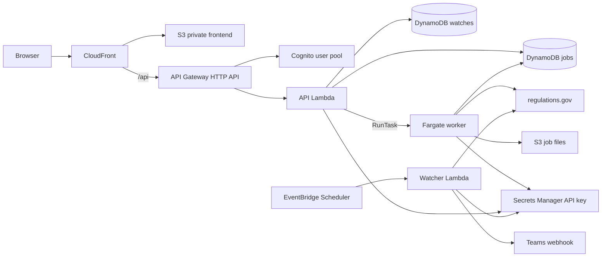
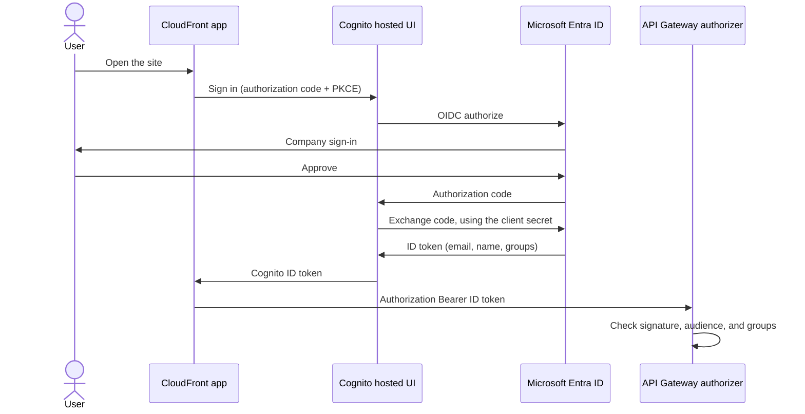

# Regulations comments

A web workspace for downloading every public comment on a regulations.gov document, plus the original command-line puller.

Large rules need one API call per comment, and a key is limited to about 1,000 calls an hour, so a pull is a **background job** with progress. It is not a request the browser waits on.

The CLI still works: `python pull_docket_comments.py --document-id FDA-2025-N-3262-0001`.

## Architecture



The browser only talks to CloudFront. `/api/*` is the HTTP API. Everything else is the React app in a private S3 bucket, reached through an origin access control. Sign-in is the Cognito hosted UI. The API Lambda checks the Cognito JWT, writes a job row, and starts one Fargate task. That task is the existing puller. It writes progress back to DynamoDB and files to S3. Downloads are presigned URLs that expire. A weekday schedule runs a second Lambda that posts to Teams only when a watched document has new comments.

There is no server sitting idle between pulls. Fargate starts when a job starts and exits when the job finishes.

## Why each service is here

- **S3 + CloudFront + OAC.** The React app is static. A private bucket plus CloudFront is the usual way to host it without a public bucket. OAC is the current CloudFront-to-S3 access method (not the older origin access identity).
- **Route 53 + ACM.** Optional. An alias record points your DNS name at CloudFront. The certificate must be in **us-east-1** because that is the only region CloudFront accepts. Leave the domain parameters empty and the CloudFront URL is the site.
- **Cognito.** Hosted UI so the app does not store passwords. The company IdP (Microsoft Entra ID) is a later federation step, documented below. Until then an admin creates users in the pool.
- **API Gateway HTTP API.** Cheaper and simpler than a REST API, and it checks the Cognito JWT before the Lambda runs.
- **Lambda.** Short work only: preview (two API calls), create a job, read status, list comments, mint a download URL, save a watch. It does not download the docket.
- **DynamoDB.** One item per job, keyed by the signed-in user, so people only see their own history. On-demand capacity, because this is bursty.
- **ECS Fargate.** The pull can run for hours and needs a disk for files. Lambda's 15-minute limit does not fit. Fargate runs the same Python package as the CLI, then stops. No EC2 instances to patch.
- **Secrets Manager.** The regulations.gov key, and each Teams webhook URL. Neither is in the frontend bundle or in git.
- **EventBridge Scheduler.** One weekday schedule for all watches. The expression is a deploy parameter. The checker stays silent when nothing is new.

## What the app does

1. **Preview.** A document ID shows title, agency, type, comment-period dates, whether it is open, the comment count (`meta.totalElements`), and an estimated duration at 1,000 calls/hour. A document that is not a Proposed Rule gets a warning. You can still pull it.
2. **Background pull.** Progress shows comments saved, attachments downloaded, and failures. Refreshing the page reads the same job row. History and Watches each have **My items** and **Team**. My items is only what you created. Team is every signed-in user's jobs and watches, with the creator's name, email, and time. Anyone signed in can open and download a teammate's results. Only the owner, or someone in the Cognito group `regs-admins`, can cancel or delete a job or edit or delete a watch. The API enforces that. The lists use a DynamoDB index on `scope = team`, not a table scan.
3. **Results.** A chart of comments by day, top organizations, attachment types, form-letter clusters with a representative text, and a searchable paged table. Each row links to the comment on regulations.gov. Download the zip or either CSV.
4. **Form letters.** After the pull, the worker normalizes comment text, builds word shingles, and clusters with MinHash. Defaults: similarity 0.8, shingle size 5, 64 hashes, 16 bands, minimum cluster size 3. Those are task environment variables (`CLUSTER_THRESHOLD`, `CLUSTER_SHINGLE_SIZE`, `CLUSTER_NUM_PERM`, `CLUSTER_BANDS`, `CLUSTER_MIN_SIZE`). The app CSV adds `clusterId` and `isFormLetter`. The CLI CSV does not, so existing CLI output stays the same.
5. **Watches.** A document ID plus a Teams webhook. The webhook is stored in Secrets Manager in AWS (on disk only in local mode) and is never returned to the browser. The daily check lists the newest page of comments, ignores ids it has already reported, and posts an Adaptive Card only when there is something new.

The comment table is filtered in the API from `comments_index.json`. That is the right shape for a teaching deploy and for rules with thousands of comments. A docket with tens of thousands of comments should move that index to Athena or OpenSearch later. The pull itself does not have that limit.

## Cost notes

Rough monthly cost when the app is idle, in us-east-1, excluding tax and data transfer:

| Piece | Idle | When you pull |
| --- | --- | --- |
| CloudFront + S3 frontend | a few dollars | pennies per user |
| HTTP API + Lambda | near zero at low traffic | preview and status reads |
| DynamoDB on-demand | near zero | one write per progress update |
| Fargate (1 vCPU, 2 GB) | **$0** (no task running) | about $0.05 per hour the task runs |
| NAT gateway | **$0** with the default public-subnet layout | about $32/month plus data if you turn `createNat` on |
| Secrets Manager | about $0.40 per secret | one secret for the API key, plus one per watch |
| Cognito | free tier covers a small team | hosted UI is included |
| ECR | a few cents for the worker image | |

A 20,000-comment rule is about 20,000 API calls, so about 20 hours of Fargate if the key stays at 1,000 calls/hour. That is on the order of one dollar of compute, plus S3 storage for the files. The NAT gateway would cost more than the pull. The default VPC mode therefore uses **two public subnets and a public IP on the task**, with a security group that allows outbound traffic only.

If the security team does not allow tasks with public IPs, deploy with `-c createNat=true` (about $32/month for the NAT gateway even when nothing is running) or `-c vpcMode=import` and point at private subnets that already have a NAT.

## Parameters you must supply

| Value | Where it goes | Required |
| --- | --- | --- |
| AWS account and region | `CDK_DEFAULT_ACCOUNT`, `CDK_DEFAULT_REGION`. Use **us-east-1** if you want this stack to create the CloudFront certificate. | Yes |
| regulations.gov API key | After deploy: `aws secretsmanager put-secret-value --secret-id regs-comments/api-key --secret-string 'YOUR_KEY'` | Yes, before a real pull |
| Cognito domain prefix | `-c cognitoDomainPrefix=your-company-regs` (lowercase, unique in the region). Default `regs-comments-dev` will collide if someone else used it. | Yes for a real deploy |
| Domain name | `-c domainName=comments.example.com` | No |
| Hosted zone | `-c hostedZoneId=Z... -c hostedZoneName=example.com` | Only with a domain |
| Certificate ARN | `-c certificateArn=arn:aws:acm:us-east-1:...` | Only if the stack is **not** in us-east-1 and you set a domain |
| VPC | `-c vpcMode=create` (default) or `import` | Yes, choose one |
| Imported VPC | `-c vpcId=vpc-... -c subnetIds=subnet-a,subnet-b -c availabilityZones=us-east-1a,us-east-1b` | Only when importing |
| Public IP on tasks | `-c assignPublicIp=false` for private imported subnets | Only when importing |
| NAT | `-c createNat=true` | No |
| Watch schedule | `-c schedule='cron(0 8 ? * MON-FRI *)'` | No. Time zone is America/New_York |
| Teams webhook | Typed into the app per watch. Not a deploy parameter. | Only if you want alerts |
| Entra tenant ID | `-c entraTenantId=` the Directory (tenant) ID | Only for company SSO |
| Entra application (client) ID | `-c entraClientId=` | Only for company SSO |
| Entra client secret ARN | `-c entraClientSecretArn=` a Secrets Manager ARN. The secret value is not a CDK parameter. | Only for company SSO |
| Entra admin group object ID | `-c entraAdminGroupId=` optional. Members are treated like `regs-admins`. | No |
| Entra groups claim name | `-c entraGroupsClaim=groups` (the default) | No |
| Hide username and password | `-c ssoOnly=true` so the hosted UI offers Entra only | No |

Do not put the API key or a webhook URL in `cdk.json`, the frontend, or git.

## Deploy from Windows PowerShell

Install Node.js 22, Python 3.12, Docker, and the AWS CLI. Configure a profile that can deploy CloudFormation, or use the GitHub Action below instead of doing this by hand.

```powershell
cd C:\src\Reglations.gov
py -m venv .venv
.\.venv\Scripts\Activate.ps1
pip install -r requirements.txt -r infra/requirements.txt
npm install -g aws-cdk@2
python scripts/package_lambda.py

$env:CDK_DEFAULT_ACCOUNT = "123456789012"
$env:CDK_DEFAULT_REGION = "us-east-1"
cdk deploy RegsComments --require-approval never -c cognitoDomainPrefix=your-company-regs
```

If activation is blocked:

```powershell
Set-ExecutionPolicy -Scope CurrentUser RemoteSigned
.\.venv\Scripts\Activate.ps1
```

Then build the worker image and push it. The repository does not exist until the deploy above finishes.

```powershell
$account = aws sts get-caller-identity --query Account --output text
$region = "us-east-1"
aws ecr get-login-password --region $region | docker login --username AWS --password-stdin "$account.dkr.ecr.$region.amazonaws.com"
docker build -t "$account.dkr.ecr.$region.amazonaws.com/regs-comments-worker:latest" .
docker push "$account.dkr.ecr.$region.amazonaws.com/regs-comments-worker:latest"
```

Store the API key:

```powershell
aws secretsmanager put-secret-value --secret-id regs-comments/api-key --secret-string "your-api.data.gov-key" --region us-east-1
```

Publish the site. Stack outputs supply the bucket, the CloudFront distribution, and the Cognito values.

```powershell
cd frontend
npm ci
npm run build
$bucket = aws cloudformation describe-stacks --stack-name RegsComments --query "Stacks[0].Outputs[?OutputKey=='FrontendBucket'].OutputValue" --output text
$dist = aws cloudformation describe-stacks --stack-name RegsComments --query "Stacks[0].Outputs[?OutputKey=='DistributionId'].OutputValue" --output text
$client = aws cloudformation describe-stacks --stack-name RegsComments --query "Stacks[0].Outputs[?OutputKey=='UserPoolClientId'].OutputValue" --output text
$cognito = aws cloudformation describe-stacks --stack-name RegsComments --query "Stacks[0].Outputs[?OutputKey=='CognitoHostedUi'].OutputValue" --output text
$site = aws cloudformation describe-stacks --stack-name RegsComments --query "Stacks[0].Outputs[?OutputKey=='SiteUrl'].OutputValue" --output text
@{ clientId = $client; cognitoDomain = $cognito; redirectUri = "$site/" } | ConvertTo-Json -Compress | Set-Content -Encoding utf8 dist\config.json
aws s3 sync dist/ "s3://$bucket" --delete
aws cloudfront create-invalidation --distribution-id $dist --paths "/*"
```

Create the first user in the Cognito console (the pool does not allow open sign-up). They sign in through the hosted UI.

### Command Prompt

Same steps. Activate with `.venv\Scripts\activate.bat` and set variables with `set CDK_DEFAULT_REGION=us-east-1`.

### macOS / Linux

```bash
python3 -m venv .venv
source .venv/bin/activate
pip install -r requirements.txt -r infra/requirements.txt
npm install -g aws-cdk@2
python scripts/package_lambda.py
export CDK_DEFAULT_ACCOUNT=123456789012
export CDK_DEFAULT_REGION=us-east-1
cdk deploy RegsComments --require-approval never -c cognitoDomainPrefix=your-company-regs
```

The image push and the frontend sync are the same commands as in PowerShell, without the `$` sigils.

## Custom domain

Deploy in us-east-1, with the zone already in this account:

```powershell
cdk deploy RegsComments --require-approval never `
  -c cognitoDomainPrefix=your-company-regs `
  -c domainName=comments.example.com `
  -c hostedZoneId=Z0123456789ABC `
  -c hostedZoneName=example.com
```

CDK creates the certificate, validates it with a DNS record in that zone, and adds an alias A record. CloudFront's domain is still in the outputs if you need it.

If the rest of the stack must live in another region, create the certificate yourself in **us-east-1** and pass `-c certificateArn=...`. The alias record is still created in the hosted zone.

## VPC choices

**Create, no NAT (default).** Two public subnets, internet gateway, Fargate task gets a public IP. Outbound only. Cheapest, and enough for calling regulations.gov and AWS APIs. Some security standards disallow public task IPs.

**Create, with NAT.** `-c createNat=true`. Tasks run in private subnets. A NAT gateway stays up all month. Use this when public IPs are not allowed and you do not already have a VPC.

**Import.** The two company account types can pass different ids:

```powershell
cdk deploy RegsComments --require-approval never `
  -c vpcMode=import `
  -c vpcId=vpc-0123 `
  -c subnetIds=subnet-aaa,subnet-bbb `
  -c availabilityZones=us-east-1a,us-east-1b `
  -c assignPublicIp=false
```

`assignPublicIp=true` means those subnets are public. `false` means they are private and already have a route to the internet (a NAT or egress VPC). This stack does not modify an imported VPC.

## How SSO works

People do not type a password into this app. The browser sends them to Cognito's hosted UI, Cognito sends them to Microsoft Entra, and Entra sends them back. Cognito then gives the browser an ID token. The API checks that token. The first successful sign-in creates the Cognito user automatically. Open sign-up with a local password stays off.



Pass all three, or none. A partial set fails `cdk synth`.

```powershell
aws secretsmanager create-secret --name regs-comments/entra-client-secret --secret-string "THE_CLIENT_SECRET"
cdk deploy RegsComments --require-approval never `
  -c cognitoDomainPrefix=your-company-regs `
  -c entraTenantId=00000000-0000-0000-0000-000000000000 `
  -c entraClientId=11111111-1111-1111-1111-111111111111 `
  -c entraClientSecretArn=arn:aws:secretsmanager:us-east-1:123456789012:secret:regs-comments/entra-client-secret-AbCdEf `
  -c ssoOnly=true `
  -c entraAdminGroupId=22222222-2222-2222-2222-222222222222
```

`-c ssoOnly=true` removes the Cognito username box from the hosted UI. Leave it off if you still want a break-glass local user. The client secret never goes in `-c` or in git. CloudFormation reads it from Secrets Manager at deploy time.

Mapped claims: Entra `email` to Cognito email, `name` to full name, `preferred_username` to preferred username, and the `groups` claim (override with `-c entraGroupsClaim=`) to `custom:groups`. The API treats the Cognito group `regs-admins` as an admin. If you also pass `-c entraAdminGroupId`, a user whose groups claim contains that Entra group object ID is an admin too. Add people to `regs-admins` in the Cognito console when you are not using the Entra group id.

### What to ask the Entra admin for

Ask for an **app registration** (OIDC), not a SAML app, unless you are using the alternative below.

| Ask for | What you do with it |
| --- | --- |
| Directory (tenant) ID | `-c entraTenantId` |
| Application (client) ID | `-c entraClientId` |
| A client secret | Store it yourself: `aws secretsmanager create-secret --name regs-comments/entra-client-secret --secret-string '...'`. Pass that secret's ARN as `-c entraClientSecretArn`. Do not email the secret back into the repo. |
| Group object ID of the team that may administer pulls, if you want Entra to decide admins | `-c entraAdminGroupId` |

Ask them to set the app registration like this:

1. Redirect URI (Web): `https://<cognitoDomainPrefix>.auth.<region>.amazoncognito.com/oauth2/idpresponse`. After deploy this exact URL is the stack output `EntraRedirectUri`. Example: `https://your-company-regs.auth.us-east-1.amazoncognito.com/oauth2/idpresponse`.
2. ID token: include the email, name, and preferred_username claims. If admins are an Entra group, also emit the security group object IDs in the `groups` claim (Token configuration → Add groups claim → Security groups → Group ID, emitted in the ID token).
3. API permissions, delegated: `openid`, `profile`, `email`, and Microsoft Graph `User.Read`. Grant admin consent.
4. To limit who can sign in, turn on **Assignment required** on the Enterprise application and assign the security group that should have access. Anyone not assigned is rejected by Entra before Cognito creates a user.
5. Supported account types: single tenant (this organization only), unless the company standard says otherwise.

Cognito's own callback and logout URLs, which Entra does **not** use, are the stack outputs `CognitoCallbackUrls` and `CognitoLogoutUrls`. They are:

- `https://<cloudfront-domain>/`
- `https://<your custom domain>/` when you set `domainName`
- `http://localhost:5173/` for local development

### SAML instead of OIDC

This stack wires OIDC. SAML is the fallback if the identity team will not issue a client secret. You would add a Cognito SAML identity provider by hand (metadata URL `https://login.microsoftonline.com/{tenant}/federationmetadata/2007-06/federationmetadata.xml`, ACS URL `https://<cognitoDomainPrefix>.auth.<region>.amazoncognito.com/saml2/idpresponse`) and attach it to the app client. Do that only if OIDC is refused. The rest of the app still consumes the Cognito JWT.

## Teams webhook

In Teams, create a workflow from the template **Post to a channel when a webhook request is received** (Power Automate / Teams Workflows). Copy the webhook URL it shows. That URL is a secret.

In the app, open Watches, enter the document ID and paste the URL once. The API stores it in Secrets Manager under `regs-comments/teams/...` and the page only shows that a webhook is configured.

The checker posts an Adaptive Card:

- title: how many new comments, and the document ID
- body: how many look like form letters, and how many look unique
- links: the regulations.gov document, and this site

If the newest list page contains only ids it has already reported, it does not call the webhook.

The list endpoint returns titles, not the full comment body, so the daily classification uses titles. The full-text clustering still happens on a real pull.

## CI/CD with GitHub OIDC

`.github/workflows/ci.yml` runs tests, `cdk synth`, and the frontend build on every pull request. On a push to `main`, or a manual run, it deploys **only if** the repository variable `AWS_DEPLOY_ROLE_ARN` is set. Until then the deploy job exits without touching AWS. No long-lived access keys.

One-time role in the AWS account:

1. IAM identity provider `token.actions.githubusercontent.com`, audience `sts.amazonaws.com`.
2. Role trusted by that provider, restricted to `repo:YOUR_ORG/Reglations.gov:ref:refs/heads/main`.
3. Permission to deploy this stack: CloudFormation, S3, CloudFront, IAM, Lambda, API Gateway, Cognito, DynamoDB, ECS, ECR, EC2 (for the optional VPC), Secrets Manager, EventBridge Scheduler, Route 53, ACM, and `iam:PassRole` for the roles the stack creates. AdministratorAccess is enough for a sandbox and too much for production. Tighten it after the first successful deploy by replacing it with the CloudFormation change-set's resource list.
4. Repository variables: `AWS_DEPLOY_ROLE_ARN` and `AWS_REGION` (`us-east-1`).

The workflow deploys the stack, pushes `regs-comments-worker:latest`, writes `config.json` from the stack outputs, and syncs `frontend/dist` to the site bucket.

## Local development

PowerShell, from the repo root. This uses a built-in sample document and does not call regulations.gov.

```powershell
py -m venv .venv
.\.venv\Scripts\Activate.ps1
pip install -r requirements.txt
$env:REGS_FIXTURE = "1"
$env:REGS_LOCAL = "1"
py -m api.local_server
```

In a second terminal:

```powershell
cd frontend
npm ci
npm run dev
```

Open http://localhost:5173 . The sample document id is `FDA-2025-N-3262-0001`. Starting a pull finishes in a few seconds and opens the dashboard.

To hit the real API instead, set `REGS_FIXTURE=0` and `REGS_API_KEY` in the API terminal. `DEMO_KEY` is only enough for a preview, not a full pull.

macOS / Linux: `source .venv/bin/activate`, `export REGS_FIXTURE=1`, `python -m api.local_server`.

## Command-line puller

The implementation lives in `regs_pull`. `pull_docket_comments.py` is the CLI.

```powershell
py -m venv .venv
.\.venv\Scripts\Activate.ps1
pip install -r requirements.txt
$env:REGS_API_KEY = "your-key"
python pull_docket_comments.py --document-id FDA-2025-N-3262-0001
```

A short test run:

```powershell
python pull_docket_comments.py --document-id FDA-2025-N-3262-0001 --max-comments 5
```

Command Prompt uses `.venv\Scripts\activate.bat` and `set REGS_API_KEY=your-key`. macOS and Linux use `source .venv/bin/activate` and `export REGS_API_KEY='your-key'`.

`--docket FDA-2025-N-3262` pulls Proposed Rule documents only. `--all-documents` pulls every type. File downloads use a browser User-Agent and do not send the API key. Output CSVs are UTF-8 with a BOM. `localPath` in `attachments.csv` always uses backslashes. `comments.csv` `id`, `attachments.csv` `commentId`, and the folder name under `attachments` are the same comment.

| CLI column file | Columns |
| --- | --- |
| `comments.csv` | `id`, `documentId`, `title`, `postedDate`, `receiveDate`, `firstName`, `lastName`, `organization`, `comment`, `attachmentCount`, `attachmentFiles` |
| `attachments.csv` | `commentId`, `documentId`, `fileName`, `localPath`, `format`, `sourceUrl`, `downloaded`, `fileSizeBytes` |

The web app's `comments.csv` adds `clusterId` and `isFormLetter`.

## Tests

```powershell
python -m unittest discover -s tests -v
cd frontend
npm run lint
npm run build
python ..\scripts\package_lambda.py
cd ..
$env:CDK_DEFAULT_REGION = "us-east-1"
cdk synth
```

`cdk synth` does not need AWS credentials when `CDK_DEFAULT_ACCOUNT` is unset. A deploy does.

The dev-only AgentCore demo is separate from this web app. Deploy and tear it down with [docs/agentcore-demo/DEPLOY.md](docs/agentcore-demo/DEPLOY.md).
